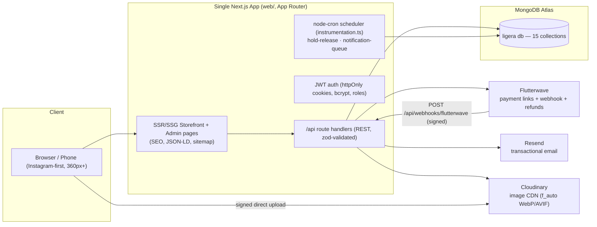

# Ligera Workflow Specification Suite

Production-ready engineering workflow suites generated from the **Ligera PRD** (23 pages) via the
`prd-to-workflow` skill, tailored to this repository after an interactive architectural interview
with the project owner (Nov 2026).

Each domain folder contains the canonical five files:

```
workflows/
├── README.md                 # This index — canonical cross-domain contract (source of truth)
├── platform/                 # Next.js scaffold, MongoDB, auth, uploads, scheduler, analytics, migration
│   ├── prd.md  ├── specs.md  ├── api-contract.md  ├── steps.md  ├── implementation.md
├── catalog/                  # Products, variants, categories/spaces, search, storefront + admin CRUD
├── checkout-payments/        # Cart, checkout, delivery fees, stock holds, Flutterwave links + webhook
├── orders-fulfillment/       # 9-state order lifecycle, tracking, packing slips, refunds, CSV export
├── custom-orders/            # Custom request form, admin inbox, quote → payment link → order
├── notifications/            # Resend email service, queue, retries, once-per-event guarantee
└── admin-portal/             # Dashboard, activity log, settings, content pages, customers, zones
```

**Implementation order:** `platform` → `catalog` → `checkout-payments` → `orders-fulfillment` →
`notifications` → `custom-orders` → `admin-portal`.

---

## 1. Decision Log (from the architectural interview)

| # | Decision | Choice |
|---|----------|--------|
| D1 | Frontend | **Migrate to Next.js** (App Router, TypeScript, SSR/SSG for SEO — FR-042) replacing the Vite SPA |
| D2 | Shape | **Single fullstack Next.js app** serving storefront pages + `/api` route handlers. `backend/` (Express) is retired |
| D3 | Database | **MongoDB Atlas** via Mongoose. Fresh rebuild of the data model to PRD §16. Supabase Postgres removed |
| D4 | Stock concurrency | Atomic single-document `findOneAndUpdate` with `stockQty`/`heldQty` + in-process **node-cron** scheduler (least resources; low-volume case) |
| D5 | Payments | **Flutterwave payment links only** — every order (cart and custom quote) receives a hosted payment link; server-side webhook + verify marks Paid (FR-016) |
| D6 | Email | **Resend** (NT-001 within 60s), SPF/DKIM/DMARC on the Ligera domain |
| D7 | Admin auth | **Custom JWT + bcrypt** (httpOnly cookies), roles `owner` + `staff`, rate-limited login, optional TOTP 2FA for Owner. Supabase Auth removed |
| D8 | Images | **Cloudinary** (signed direct browser upload, `f_auto/q_auto` WebP/AVIF, 150KB mobile budget) |
| D9 | Order lifecycle | Full **9-state** PRD §7.5 machine with separate `paymentStatus` and `statusTimeline[]` |
| D10 | API surface | Unversioned `/api/*` route handlers, following the existing repo convention |
| D11 | UI foundation | **shadcn/ui + Tailwind CSS 4** with excerpts from **Watermelon UI** (ui.watermelon.sh — Tailwind/Radix registry: animated interactions, blocks, dashboard sections) for the premium brand feel |
| D12 | Workflow layout | Split by domain — 7 folders at repo root |

## 2. Target System Architecture



- **App root:** `web/` is rebuilt as the single Next.js app (`ligera-web`). `backend/` is
  retired in the platform migration phase. `docker-compose.yml` reduced to one app service
  (optional — the app deploys to any Node host or Vercel; MongoDB is always Atlas).
- **Money:** integer Naira (₦) throughout, no fractions (PRD: Naira-only MVP).
- **Testing:** Vitest + mongodb-memory-server + Testing Library; TDD per `implementation.md`.

## 3. Canonical Cross-Domain Contract

Every domain doc uses **exactly** these names. Phase-4 audit checks them for identity across
`specs.md`, `api-contract.md`, `steps.md`, `implementation.md`.

### 3.1 Collections (Mongoose, db `ligera`)

| Collection | Purpose | PRD |
|---|---|---|
| `products` | Catalog items with scent notes, spaces, images, SEO | §16 |
| `variants` | Size variants: sku, price, salePrice, stockQty, heldQty, costPrice | §16 |
| `categories` | Typed taxonomy: `category` \| `space` \| `collection`, parentId | §16 |
| `customers` | Guest-checkout customer records keyed by email, marketing consent | §16 |
| `orders` | Order with items snapshot, status machine, timeline, Flutterwave link | §16 |
| `payments` | Flutterwave transaction per order: reference, status, rawEvent | §16 |
| `delivery_zones` | Zone name, fee, etaText, active | §16 |
| `custom_requests` | Bespoke request inbox with quote lifecycle | §16 |
| `stock_adjustments` | Signed stock changes with reason + user | §16 |
| `notification_logs` | Email queue/log: type, recipient, status, retryCount, dedupeKey | §16 |
| `users` | Admin/staff: bcrypt hash, role, optional TOTP | §16 |
| `activity_logs` | Append-only admin audit trail (before/after) | §16 |
| `settings` | Singleton: store, delivery config, homepage, templates | §16 |
| `content_pages` | Editable pages: our-story, faqs, delivery-returns, policies | AD-061 |
| `counters` | Atomic sequence for `LG-000001` / `CR-000001` numbers | — |

### 3.2 Enums (exact strings)

| Enum | Values |
|---|---|
| `ProductStatus` | `draft` · `published` · `archived` |
| `CategoryType` | `category` · `space` · `collection` |
| `OrderStatus` | `pending_payment` · `paid` · `processing` · `ready_for_pickup` · `out_for_delivery` · `delivered` · `cancelled` · `refunded` · `abandoned` |
| `PaymentStatus` | `pending` · `successful` · `failed` · `refunded` |
| `DeliveryMethod` | `delivery` · `pickup` |
| `CustomRequestStatus` | `new` · `quoted` · `accepted` · `declined` · `completed` |
| `UserRole` | `owner` · `staff` |
| `StockAdjustmentReason` | `restock` · `damaged` · `sample` · `correction` · `order_paid` · `order_cancelled` |
| `NotificationType` | `order.paid.customer` · `order.paid.owner` · `order.status.customer` · `order.cancelled.customer` · `custom_request.submitted.customer` · `custom_request.submitted.owner` · `custom_request.quoted.customer` · `stock.low.owner` · `payment.mismatch.owner` |

### 3.3 Order status transition matrix (PRD §7.5)

```text
pending_payment ──► paid ──► processing ──► ready_for_pickup ──► delivered
      │                │           └──────────► out_for_delivery ──► delivered
      │                └──► cancelled ──► refunded
      └──► abandoned (30-min hold expiry; owner "Verify payment" may revive → paid)
```

- Customer is emailed on `paid` and on **every** later status change (NT-003).
- Pickup orders: `processing → ready_for_pickup → delivered` (collected).
- Stock commits on `paid`; returns on `cancelled` of a paid order (per-order toggle).

### 3.4 Stock semantics (FR-015, AC-003/005)

- `variant.stockQty` = on-hand · `variant.heldQty` = reserved for `pending_payment` orders ·
  `available = stockQty − heldQty`.
- Reserve: atomic `findOneAndUpdate({ _id, $expr: available ≥ qty }, { $inc: { heldQty: qty } })`.
- Commit on Paid: `$inc { stockQty: −qty, heldQty: −qty }` + `stock_adjustments` (`order_paid`).
- Release: expiry job / cancel → `$inc { heldQty: −qty }`; paid-cancel → `$inc { stockQty: +qty }`
  (`order_cancelled`). Made-to-order products never hold stock (AD-033).
- Low-stock alert when `available ≤ lowStockThreshold` after commit → `stock.low.owner` (NT-007).

### 3.5 API envelope & errors (repo convention, unversioned)

- Success: the raw resource / array (optionally `{ data, meta }` for paginated lists).
- Error: `{ "error": "<plain-language message>", "code": "<STABLE_CODE>", "details": [...]? }`
  with HTTP 400 / 401 / 403 / 404 / 409 / 422 / 429 / 500. `details` carries zod issues.
- All bodies `application/json` (except CSV downloads and the packing-slip HTML).

### 3.6 Route map (domain → endpoints)

| Domain | Endpoints |
|---|---|
| platform | `POST /api/auth/login` · `POST /api/auth/logout` · `POST /api/auth/refresh` · `GET /api/auth/me` · `POST /api/auth/password/request-reset` · `POST /api/auth/password/confirm-reset` · `POST /api/auth/2fa/setup` · `POST /api/auth/2fa/enable` · `POST /api/admin/uploads/sign` · `GET /api/health` |
| catalog (public) | `GET /api/products` · `GET /api/products/:slug` · `GET /api/search/suggest` · `GET /api/categories` |
| catalog (admin) | `GET /api/admin/products` · `POST /api/admin/products` · `PUT /api/admin/products/:id` · `PATCH /api/admin/products/:id/status` · `POST /api/admin/products/:id/duplicate` · `DELETE /api/admin/products/:id` · `POST /api/admin/products/:id/variants` · `PUT /api/admin/variants/:id` · `DELETE /api/admin/variants/:id` · `POST /api/admin/variants/:id/stock` · `GET /api/admin/variants/low-stock` · `GET/POST/PUT/DELETE /api/admin/categories[/:id]` · `GET /api/admin/products/export.csv` · `POST /api/admin/products/import.csv` |
| checkout-payments | `GET /api/delivery-zones` · `POST /api/checkout/quote` · `POST /api/checkout/orders` · `POST /api/webhooks/flutterwave` · `POST /api/orders/lookup` |
| orders-fulfillment | `GET /api/admin/orders` · `GET /api/admin/orders/:id` · `PATCH /api/admin/orders/:id/status` · `POST /api/admin/orders/:id/cancel` · `POST /api/admin/orders/:id/refund` · `GET /api/admin/orders/:id/verify-payment` · `GET /api/admin/orders/:id/packing-slip` · `GET /api/admin/orders/export.csv` |
| custom-orders | `POST /api/custom-requests` · `GET /api/admin/custom-requests` · `GET /api/admin/custom-requests/:id` · `PATCH /api/admin/custom-requests/:id/status` · `POST /api/admin/custom-requests/:id/quote` |
| notifications | `GET /api/admin/notifications` · `POST /api/admin/notifications/:id/resend` |
| admin-portal | `GET /api/admin/dashboard` · `GET /api/admin/activity-logs` · `GET/PUT /api/admin/settings` · `GET/PUT /api/admin/content[/:slug]` · `GET /api/content/:slug` · `GET /api/admin/customers` · `GET /api/admin/customers/export.csv` · `GET/POST/PUT/DELETE /api/admin/delivery-zones[/:id]` |

Role guards: **public** (no auth) · **staff** (`owner` or `staff`) · **owner** (revenue, pricing,
settings, users, exports). Staff cannot see revenue aggregates or change prices/settings/users
(AC-009): dashboard, settings, content, customers, CSV exports, product/variant pricing writes
and category management are `owner`-only.

### 3.7 Storefront routes (Next.js App Router)

`/` · `/shop` (+ `?category=&space=&q=&sort=`) · `/spaces/[slug]` · `/products/[slug]` ·
`/custom-orders` · `/cart` · `/checkout` · `/order/[orderNumber]` (confirmation) · `/track` ·
`/our-story` · `/delivery-returns` · `/faqs` · `/contact` · `/policies/[slug]` · `not-found.tsx` ·
`/admin/*` (login, dashboard, products, product editor, orders, custom-requests, settings,
customers, activity) — login-protected via `middleware.ts`.

### 3.8 Brand & design system (PRD §11 + D11)

- Gold logo mark (`#B08D57`), warm neutral backgrounds (ivory `#FAF7F2`, sand, clay), restrained
  serif display type (Fraunces) over a clean sans body (Inter), generous white space.
- shadcn/ui + Tailwind 4 tokens defined in `web/src/styles.css` (tokens: `--brand-gold`,
  `--brand-ivory`, `--brand-sand`, `--brand-charcoal`); Watermelon UI excerpts: hero reveal
  animation, product-card hover lift, marquee Instagram strip, dashboard stat blocks.
- WCAG 2.1 AA: alt text everywhere, 4.5:1 contrast, keyboard nav, visible focus (AC-013).
- LCP ≤ 2.5s on 4G; mobile images ≤ 150KB via Cloudinary `f_auto,q_auto` (AC-011).

### 3.9 Environment variables (single app)

`MONGODB_URI` · `JWT_ACCESS_SECRET` · `JWT_REFRESH_SECRET` · `FLW_PUBLIC_KEY` · `FLW_SECRET_KEY` ·
`FLW_SECRET_HASH` (webhook `verif-hash`) · `RESEND_API_KEY` · `EMAIL_FROM` (e.g.
`Ligera <orders@ligera.ng>`) · `CLOUDINARY_CLOUD_NAME` · `CLOUDINARY_API_KEY` ·
`CLOUDINARY_API_SECRET` · `APP_URL` · `ENABLE_SCHEDULER` · `GA4_ID` · `META_PIXEL_ID`.

## 4. Using this suite

1. Read `workflows/README.md` (this file) — it is the shared contract.
2. Implement domains in order; each `implementation.md` is an endpoint-by-endpoint TDD plan
   (RED → GREEN → VERIFY) using Vitest.
3. Keep enums, endpoint paths, DTO names and event names **identical** to §3 — divergence is a bug.
4. Full PRD source: `workflows/platform/prd.md` holds the complete PRD; each domain `prd.md`
   carries its curated excerpt with the exact FR/AD/NT/AC IDs it satisfies.
