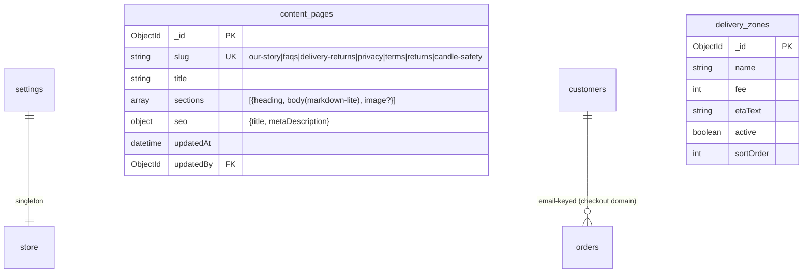

# Technical Specification: Admin Portal — Dashboard, Settings, Content & Customers

Domain: **admin-portal** — the executive dashboard (aggregations + action list), activity-log
viewer, delivery-zone CRUD, the settings singleton (store, delivery, homepage), editable
content pages (Our Story, FAQs, policies), customer list with CSV export, and the admin shell
(navigation, role-aware UI).

Shared contract: `workflows/README.md` §3. Collections `settings` and `content_pages` are
owned here; `activity_logs` schema lives in `platform/specs.md` §3.2; zones are read by
checkout (`GET /api/delivery-zones` defined in checkout-payments).

## 1. Executive Summary & Architecture Overview

The dashboard is a set of MongoDB **aggregation pipelines** over `orders` (paid only for
revenue), `variants` (stock value at cost and selling price) and `custom_requests` (action
list), parameterized by `period ∈ {today, 7d, 30d}` with automatic previous-period comparison
(AD-010–013, G4 — one request, ≤ 10 s). Zone/fee/threshold/cutoff/blackout changes are plain
`settings`/`delivery_zones` edits (AC-007: new orders snapshot current values; existing orders
keep theirs). Content pages are version-light documents rendered by the storefront; the
editor is a structured form (title, sections, SEO) rather than raw HTML for
maintainability (§11). Everything mutating here is **owner-only** and activity-logged
(AD-003); the role-aware shell hides revenue for staff (AC-009).

## 2. Feature Flowchart & Infrastructure Integration (Mermaid)

```mermaid
flowchart TD
    subgraph AdminShell["/admin (middleware-authenticated)"]
        DASH["Dashboard page"]
        SET["Settings (store · delivery · homepage · templates)"]
        CONT["Content pages editor"]
        CUST["Customers list"]
        ACT["Activity log viewer"]
        ZONES["Delivery zones CRUD"]
    end
    API["/api/admin/* route handlers (owner)"]
    AGG["Aggregation pipelines<br/>revenue · AOV · comparison · top products<br/>category revenue · stock value"]
    subgraph Atlas[("MongoDB")]
        O[("orders")]
        V[("variants + products")]
        S[("settings singleton")]
        CP[("content_pages")]
        C[("customers")]
        AL[("activity_logs")]
        DZ[("delivery_zones")]
    end
    UI["Storefront public pages<br/>(home · our-story · faqs · policies)"]

    DASH --> API --> AGG
    AGG --> O
    AGG --> V
    DASH -->|"action list"| O
    SET --> S -->|"reads on render"| UI
    CONT --> CP -->|"GET /api/content/:slug"| UI
    ZONES --> DZ -->|"checkout reads zones + settings"| O
    CUST --> C
    ACT --> AL
    API -->|"+log every mutation"| AL
```

## 3. Architecture & Data Modeling

### 3.1 Entity Relationship Diagram



`settings` singleton full shape:

```typescript
{
  store: {
    name: "Ligera", tagline: "Fragrance for every space",
    logoPublicId: "...",                    // gold mark
    contactEmail: "hello@ligera.ng", phone: "+234...",
    whatsappNumber: "234...",               // click-to-chat (FR-032/041)
    instagram: "https://instagram.com/ligera", 
    openingHours: "Mon–Sat, 9am–6pm WAT",
  },
  delivery: {
    freeDeliveryThreshold: 150000,          // AD-051 (0 = off)
    cutOffTime: "15:00",                    // WAT (AD-051)
    blackoutDates: ["2026-12-25"],          // AD-051
    pickup: { enabled: false, address: "", hours: "" },  // AD-052
  },
  payment: { payOnDelivery: false },        // FR-014 toggle
  homepage: {                               // FR-040, AD-060
    announcement: { text: "Free delivery over ₦150,000", active: true },
    hero: { headline: "Illuminate every space", subline: "...", image: { publicId, alt },
            ctaText: "Shop Now", ctaHref: "/shop" },
    featuredCollectionIds: [],              // AD-060/023
    instagramPosts: [{ publicId, alt, url }],
    newsletterEnabled: true,
  },
  seo: { defaultTitle: "Ligera — ...", defaultDescription: "..." },
  emailTemplates: {                         // AD-063 — wording overrides per NT type
    "order.paid.customer": { subject: "Your Ligera order {{orderNumber}} is confirmed", body: "..." },
    ...: { subject, body }
  },
}
```

### 3.2 Native schemas (Mongoose)

```typescript
// web/src/lib/db/models/contentPage.ts
const ContentPageSchema = new Schema(
  {
    slug: { type: String, required: true, unique: true, lowercase: true, trim: true },
    title: { type: String, required: true, maxlength: 120 },
    sections: [{
      heading: { type: String, maxlength: 160 },
      body: { type: String, maxlength: 8000 },   // markdown-lite: paragraphs, lists, links
      image: { publicId: String, alt: String },
    }],
    seo: { title: String, metaDescription: String },
    updatedBy: { type: Schema.Types.ObjectId, ref: "User" },
  },
  { timestamps: true },
);
```

`settings` singleton access (`lib/services/settings.ts`): `getSettings()` cached in-process
for 60 s (invalidated on write) — storefront reads are hot (every page render) and must not
hammer Atlas; `updateSettings(patch)` merges shallow per top-level key, validates via zod,
writes `activity_logs` with a before/after diff.

### 3.3 Migration

| Migration | Up | Down |
|---|---|---|
| `20261110000006-admin-portal.js` | Create `content_pages` + seed the 7 starter pages (Our Story placeholder, FAQs with 6 starter Q&As, Delivery & Returns, Privacy (NDPA 2023), Terms, Returns & Refunds, Candle Safety — FR-050); seed `settings` singleton defaults | Drop `content_pages`, reset `settings` |

### 3.4 Dashboard aggregation design (AD-010–013)

| Block | Pipeline (source) | Notes |
|---|---|---|
| Headline (revenue, paidOrders, AOV) | `orders` match `status ∈ {paid…delivered, refunded}` (revenue = `total`) by `paidAt`-window; `$group` sums + count; AOV = sum/count | period `today` (WAT midnight), `7d`, `30d`; previous-period same pipeline shifted — one parallel `Promise.all` |
| Top products | `orders` unwind `items` → group by `productId` → sum qty + revenue → top 5 | joins product names |
| Revenue by category | items → `$lookup` products → group by `categoryId` | feeds a simple bar chart (recharts, already in deps) |
| Low stock & sold out | `variants` + product (not madeToOrder): `available ≤ lowStockThreshold` or `available = 0` | reuses catalog service |
| Stock value | `variants`: `Σ costPrice × stockQty` (cost) and `Σ effPrice × stockQty` (selling) | AD-013; `costPrice` owner-only |
| Action list (AD-011) | counts: orders `paid` unprocessed; custom requests `new`; payments failed/abandoned | links to filtered lists |

WAT day boundaries: `today` uses Africa/Lagos midnight (not UTC) — computed with
`Intl.DateTimeFormat`-derived offset, tested fixture times.

### 3.5 Indexing strategy

| Index | Query |
|---|---|
| `orders { status: 1, paidAt: 1 }` *(add in this domain's migration)* | dashboard windows |
| `orders { "items.productId": 1, status: 1 }` | top products aggregation |
| `content_pages { slug: 1 }` unique | public render |
| existing activity/customers indexes | log paging; customer list |

### 3.6 Security & authorization rules

- All mutating endpoints + dashboard + customers + activity log: **owner-only** (AC-009 —
  revenue aggregates, settings, pricing-adjacent content). Staff hitting them → 403.
- `GET /api/content/:slug` and the settings **read** used by the storefront are public
  (cached).
- Settings writes log full before/after diffs (prices of delivery zones are money-adjacent —
  AD-003 explicitly lists delivery fees).

## 4. API Architecture & Contracts Summary

| Method | Path | Auth |
|---|---|---|
| GET | `/api/admin/dashboard` | owner |
| GET | `/api/admin/activity-logs` | owner |
| GET/PUT | `/api/admin/settings` | owner (GET public-safe fields via storefront cache) |
| GET/PUT | `/api/admin/content` + `/:slug` | owner |
| GET | `/api/content/:slug` | public |
| GET | `/api/admin/customers` (+ `export.csv`) | owner |
| GET/POST/PUT/DELETE | `/api/admin/delivery-zones[/:id]` | owner |

## 5. Verification & Testing Strategy

- Unit: WAT boundary math; period comparison windows; settings merge + cache invalidation.
- Integration: dashboard numbers against a fixture month of orders (revenue/AOV/comparison
  exact); action-list counts; zone CRUD + checkout picks up changes (AC-007 wiring);
  content page update → public read reflects it; customers list totals + consent flags; staff
  403s; activity log paging.
- E2E manual: G4 — dashboard answers "how much this week and what's low" in one screen.
