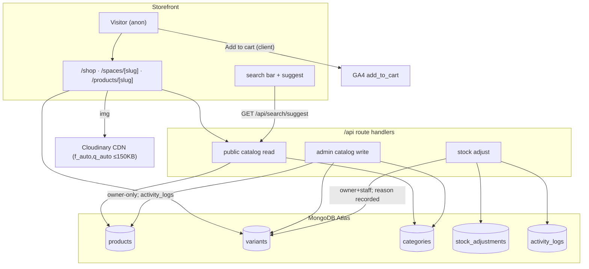
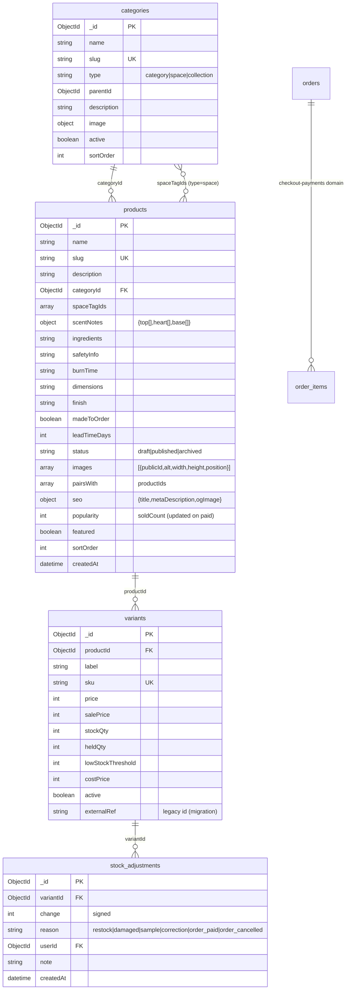

# Technical Specification: Product Catalog, Discovery & Inventory

Domain: **catalog** — products, variants, category/space taxonomy, storefront discovery
(browse, search, filter, sort), admin product management, stock adjustments, CSV import/export,
and the product SEO surface.

Shared contract: `workflows/README.md` §3 (collections, enums, envelope, stock semantics).

## 1. Executive Summary & Architecture Overview

The catalog is document-oriented: a `products` collection holds brand/rich content (scent
notes, images, story, SEO) and a sibling `variants` collection holds purchasable units (sku,
price, salePrice, stockQty, heldQty). **Money stays integer Naira.** A single `categories`
collection with a `type` discriminator (`category` | `space` | `collection`) implements both
"Shop by Category" and "Shop by Space" (FR-004, AD-023) without parallel taxonomies. Stock
mutations are always either (a) manual adjustments with reason + actor (AD-030), or (b) checkout
reservations and paid-order commits owned by `checkout-payments` — both funnel through atomic
single-document `findOneAndUpdate` so the last unit cannot be sold twice (AC-005, README §3.4).

Admin writes are role-partitioned (AC-009): pricing/status/category/CSV are `owner`-only; stock
read + manual adjustment are `staff`-allowed. Every mutation writes `activity_logs`.

## 2. Feature Flowchart & Infrastructure Integration (Mermaid)



## 3. Architecture & Data Modeling

### 3.1 Entity Relationship Diagram



### 3.2 Native schema (Mongoose) — `web/src/lib/db/models/`

```typescript
// product.ts
const ProductSchema = new Schema(
  {
    name: { type: String, required: true, trim: true, maxlength: 120 },
    slug: { type: String, required: true, unique: true, trim: true, lowercase: true },
    description: { type: String, default: "", maxlength: 4000 },
    categoryId: { type: Schema.Types.ObjectId, ref: "Category", default: null },
    spaceTagIds: [{ type: Schema.Types.ObjectId, ref: "Category" }],
    scentNotes: {
      top: [{ type: String, trim: true }],
      heart: [{ type: String, trim: true }],
      base: [{ type: String, trim: true }],
    },
    ingredients: { type: String, default: "" },
    safetyInfo: { type: String, default: "" },
    burnTime: { type: String, default: "" },       // candles: "45–50 hours"
    dimensions: { type: String, default: "" },     // gypsum: "12 × 8 × 3 cm"
    finish: { type: String, default: "" },         // gypsum: "Matte ivory"
    madeToOrder: { type: Boolean, default: false },
    leadTimeDays: { type: Number, default: 0 },
    status: { type: String, enum: ["draft", "published", "archived"], default: "draft", index: true },
    images: [{
      publicId: String, alt: { type: String, required: true }, width: Number, height: Number,
      position: Number,
    }],
    pairsWith: [{ type: Schema.Types.ObjectId, ref: "Product" }],
    seo: { title: String, metaDescription: String, ogImage: String },
    popularity: { type: Number, default: 0 },       // paid-order line count, for sort=popular
    featured: { type: Boolean, default: false },
    sortOrder: { type: Number, default: 0 },
    externalRef: { type: String, default: null },  // legacy Supabase id (migration idempotency)
  },
  { timestamps: true },
);

// variant.ts
const VariantSchema = new Schema(
  {
    productId: { type: Schema.Types.ObjectId, ref: "Product", required: true, index: true },
    label: { type: String, required: true, trim: true, maxlength: 60 }, // "Large — 300g"
    sku: { type: String, required: true, unique: true, trim: true, uppercase: true },
    price: { type: Number, required: true, min: 0 },          // integer Naira
    salePrice: { type: Number, default: null, min: 0 },
    stockQty: { type: Number, default: 0 },
    heldQty: { type: Number, default: 0 },
    lowStockThreshold: { type: Number, default: 5 },
    costPrice: { type: Number, default: 0 },                  // for stock-value dashboard (AD-013)
    active: { type: Boolean, default: true },
  },
  { timestamps: true },
);

// category.ts
const CategorySchema = new Schema(
  {
    name: { type: String, required: true, trim: true, maxlength: 80 },
    slug: { type: String, required: true, unique: true, lowercase: true },
    type: { type: String, enum: ["category", "space", "collection"], required: true, index: true },
    parentId: { type: Schema.Types.ObjectId, ref: "Category", default: null },
    description: { type: String, default: "" },
    image: { publicId: String, alt: String },
    active: { type: Boolean, default: true },
    sortOrder: { type: Number, default: 0 },
  },
  { timestamps: true },
);

// stockAdjustment.ts — append-only
const StockAdjustmentSchema = new Schema(
  {
    variantId: { type: Schema.Types.ObjectId, ref: "Variant", required: true, index: true },
    change: { type: Number, required: true }, // signed
    reason: { type: String, enum: ["restock", "damaged", "sample", "correction", "order_paid", "order_cancelled"], required: true },
    userId: { type: Schema.Types.ObjectId, ref: "User", required: true },
    note: { type: String, maxlength: 500, default: "" },
  },
  { timestamps: { createdAt: true, updatedAt: false } },
);
```

### 3.3 Idempotent migrations

MongoDB migrations are Node scripts in `web/scripts/migrations/` executed with
`npx tsx scripts/migrations/<timestamp>-<name>.ts` (recorded in a `migration_locks` doc for
idempotency — re-running is a no-op). Rollback = the paired `*-down.ts`.

| Migration | Up | Down |
|---|---|---|
| `20261110000001-catalog.js` | Create `products`, `variants`, `categories`, `stock_adjustments` + indexes (§3.4) | Drop the four collections |
| `20261110000002-seed-taxonomy.js` | Seed 6 categories + 7 spaces from PRD §5 (Scented Candles, Reed Diffusers, Room & Linen Sprays, Gypsum Decor, Gift Sets & Bundles, Custom & Bespoke; Bedroom, Living Room, Bathroom, Kitchen, Office, Entryway, Events) | Remove seeded docs |

### 3.4 Indexing strategy

| Collection | Index | Query pattern | Why |
|---|---|---|---|
| `products` | `{ slug: 1 }` unique | product detail by slug | O(1) canonical lookup (FR-002) |
| `products` | `{ status: 1, categoryId: 1, sortOrder: 1 }` | category listing | shop/category pages (FR-001) |
| `products` | `{ status: 1, createdAt: -1 }` | `sort=newest` | FR-003 |
| `products` | `{ status: 1, "variants.minPrice": 0 }` *computed field* | `sort=price` | price sort (see §3.5) |
| `products` | `{ name: "text", description: "text", "scentNotes.top": "text", "scentNotes.heart": "text", "scentNotes.base": "text" }` weights `{name:10, description:3, scentNotes:5}` | keyword search + suggest | FR-003 |
| `products` | `{ spaceTagIds: 1, status: 1 }` | Shop by Space | FR-004 |
| `variants` | `{ productId: 1 }` | product page variants, stock ops | FR-002 / holds |
| `variants` | `{ sku: 1 }` unique | SKU integrity | AD-021 |
| `stock_adjustments` | `{ variantId: 1, createdAt: -1 }` | adjustment history | AD-030 |

Read-heavy storefront; writes are admin-only and low-rate → indexes trade cheap writes for fast
public reads. Scalability: 300 products × 20 variants stays trivially inside index memory; the
same shapes hold to 1,000+ products (§11).

### 3.5 Data access patterns, concurrency & atomicity

- **Price sort:** maintain `variants.minPrice` (effective price = `salePrice ?? price`, min over
  active variants) as a denormalized field on `products`, recomputed on every product/variant
  write inside the same request — avoids a cross-collection sort.
- **Availability badge (FR-005):** `available = stockQty − heldQty` summed over active variants;
  computed in the read aggregation (never stored), so it is always truthful.
- **Manual stock adjustment (AD-030):** one atomic
  `findOneAndUpdate({ _id: variantId, stockQty: { $gte: −change } }, { $inc: { stockQty: change } })`
  then insert the `stock_adjustments` doc. If the process dies between the two, the adjustment
  row is missing but stock is consistent; a reconciliation check in the admin UI surfaces drift.
- **Popularity:** `$inc popularity` per line item when an order is paid (checkout-payments
  domain) — powers `sort=popular` and dashboard top-products.
- **Slug generation:** `slugify(name)` + collision suffix `-2`, `-3`; slugs immutable after
  publish (SEO stability, AC-012).

### 3.6 Product status state machine (AD-022)

```text
draft ──publish──► published ──archive──► archived
  ▲──restore───────┘  ▲─restore───│
  └────────────────── archived ◄┘ (restore returns to draft)
```

- `published` products appear on the storefront immediately (`PATCH status` is instant —
  AD-022).
- Deleting is only allowed for `draft` or `archived` (history preservation for orders that
  reference the product via snapshots).

### 3.7 Security & authorization rules

| Operation | Role | Notes |
|---|---|---|
| Public reads (`/api/products`, suggest, categories) | anon | `status: "published"` + active variants only; sale prices exposed, cost never |
| Product create/edit/status/duplicate/delete, variants, categories, CSV | **owner** | AC-009 — staff cannot change pricing |
| Stock read + manual adjustment | owner **or staff** | AD-030 reason + user recorded |
| `costPrice` | owner-only field | redacted from staff responses |

Every admin mutation appends `activity_logs` with `before`/`after` diffs (AD-003).

## 4. API Architecture & Contracts Summary

Protocol REST, base `/api`; guards `public` / `staff` / `owner`; envelope per README §3.5.
Full matrix, DTOs and OpenAPI in `api-contract.md`.

| Method | Path | Auth |
|---|---|---|
| GET | `/api/products` | public |
| GET | `/api/products/:slug` | public |
| GET | `/api/search/suggest` | public |
| GET | `/api/categories` | public |
| GET | `/api/admin/products` · `POST /api/admin/products` · `PUT/PATCH/POST/DELETE /api/admin/products/:id...` | owner (status, duplicate, variants, categories, CSV) |
| POST | `/api/admin/variants/:id/stock` | staff |
| GET | `/api/admin/variants/low-stock` | staff |

## 5. Verification & Testing Strategy

- Unit: slug generation, effective price, badge computation, filter query builders.
- Integration (mongodb-memory-server): listing filters/sorts/pagination; search relevance
  ordering; stock adjustment atomicity under simulated concurrent `$inc`; SKU uniqueness
  (409); role redaction (`costPrice` hidden for staff).
- SEO check: rendered `generateMetadata` output per product + JSON-LD node (AC-012).
- Manual: mobile card grid 2-per-row at 390px; image weight ≤ 150KB (AC-011).
