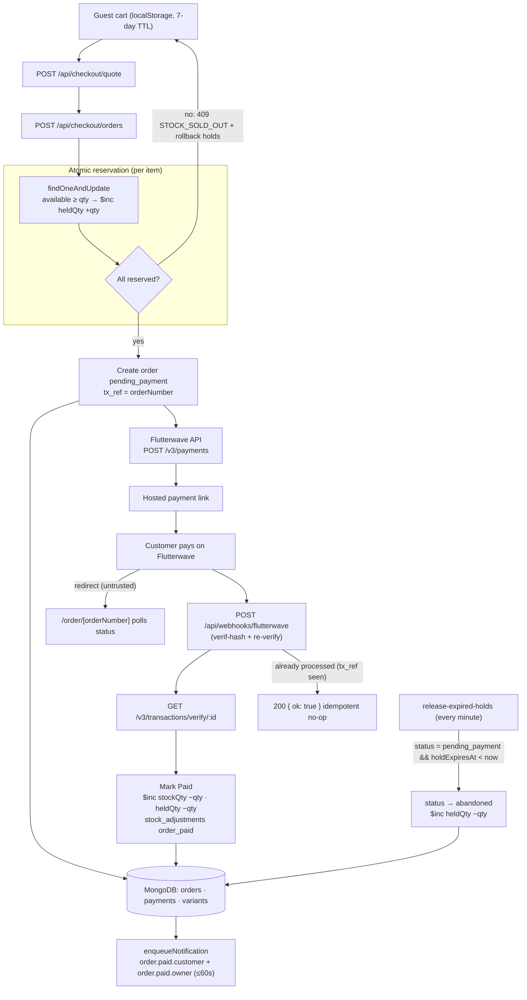
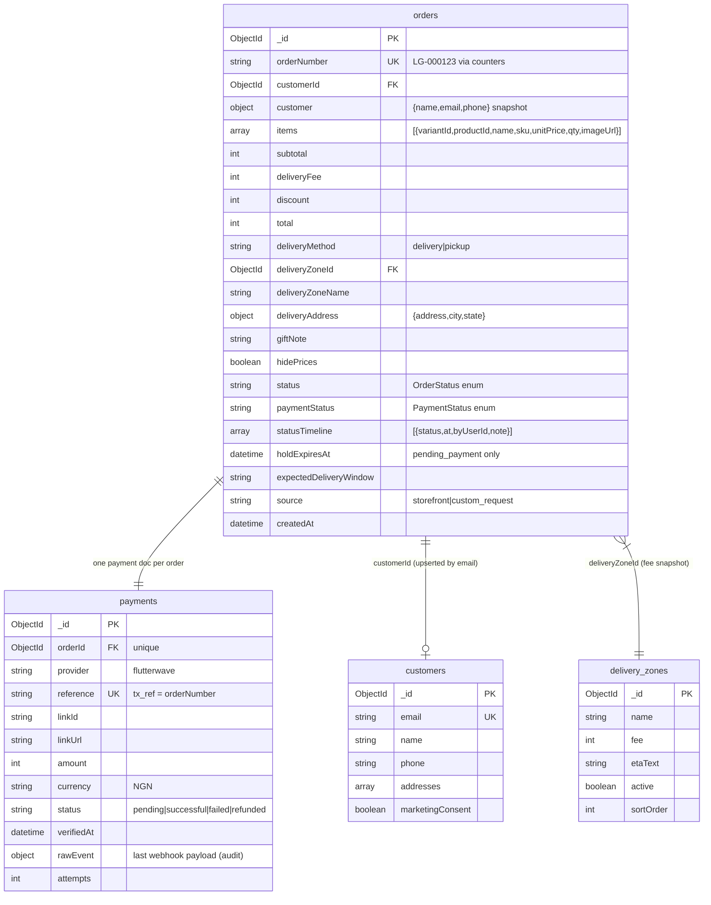

# Technical Specification: Cart, Checkout, Stock Holds & Flutterwave Payments

Domain: **checkout-payments** — the guest cart, one-page checkout, zone-based delivery fees,
30-minute stock holds, order creation, Flutterwave payment links, server-side payment
verification (webhook + verify), and the abandoned-payment lifecycle.

Shared contract: `workflows/README.md` §3 (enums, stock semantics §3.4, envelope §3.5).

## 1. Executive Summary & Architecture Overview

The checkout pipeline is deliberately ** pessimistic about stock and optimistic about payment**:
placing an order atomically reserves units (`variant.heldQty` via single-document
`findOneAndUpdate` — AC-005) before a payment link is ever issued, and an order only becomes
`paid` when Flutterwave's **server-side** webhook (signature-verified, then re-verified against
Flutterwave's transaction API) says the exact amount landed (FR-016). The browser redirect is
never trusted — it only navigates the customer to the confirmation page, which shows live
status. If payment never arrives within 30 minutes, the `release-expired-holds` cron job frees
the stock and marks the order `abandoned` (AC-003); if a charge exists without a Paid order, the
owner's "Verify payment" action re-checks and self-heals (AC-004). Every webhook delivery is
idempotent — repeated notifications neither double-update the order nor double-email (§10
email rules).

**Flutterwave integration (interview D5 — payment links only):** for each order the backend
calls `POST https://api.flutterwave.com/v3/payments` with `tx_ref = orderNumber`, exact
`amount`, `currency: "NGN"`, customer contact, `redirect_url = APP_URL/order/<orderNumber>` and
Ligera branding → the returned hosted `link` is the pay step. Webhook
`POST /api/webhooks/flutterwave` (header `verif-hash` must equal `FLW_SECRET_HASH`) is the
source of truth; `GET /v3/transactions/verify/:id` re-verifies amount/currency/status before any
state change. Refunds use `POST /v3/transactions/:id/refund` (orders-fulfillment domain).

## 2. Feature Flowchart & Infrastructure Integration (Mermaid)



## 3. Architecture & Data Modeling

### 3.1 Entity Relationship Diagram (domain slice)



### 3.2 Native schema (Mongoose) — `web/src/lib/db/models/`

```typescript
// order.ts
const OrderSchema = new Schema(
  {
    orderNumber: { type: String, required: true, unique: true },
    customerId: { type: Schema.Types.ObjectId, ref: "Customer", default: null },
    customer: {
      name: { type: String, required: true }, email: { type: String, required: true, lowercase: true },
      phone: { type: String, required: true },
    },
    items: [{
      variantId: { type: Schema.Types.ObjectId, ref: "Variant", required: true },
      productId: { type: Schema.Types.ObjectId, ref: "Product", required: true },
      name: String, sku: String, unitPrice: Number, qty: Number, imageUrl: String, // AC-007 snapshot
    }],
    subtotal: { type: Number, required: true },
    deliveryFee: { type: Number, required: true, default: 0 },
    discount: { type: Number, default: 0 },              // promo codes Phase 2
    total: { type: Number, required: true },
    deliveryMethod: { type: String, enum: ["delivery", "pickup"], default: "delivery" },
    deliveryZoneId: { type: Schema.Types.ObjectId, ref: "DeliveryZone", default: null },
    deliveryZoneName: { type: String, default: "" },
    deliveryAddress: { address: String, city: String, state: String }, // Nigerian states (§11)
    giftNote: { type: String, maxlength: 500, default: "" },           // FR-019
    hidePrices: { type: Boolean, default: false },                     // FR-019
    status: { type: String, enum: [...ORDER_STATUSES], default: "pending_payment", index: true },
    paymentStatus: { type: String, enum: ["pending", "successful", "failed", "refunded"], default: "pending" },
    statusTimeline: [{ status: String, at: Date, byUserId: Schema.Types.ObjectId, note: String }],
    holdExpiresAt: { type: Date, default: null },                      // FR-015 (30 min)
    expectedDeliveryWindow: { type: String, default: "" },             // FR-017
    restoreStockOnCancel: { type: Boolean, default: true },            // AD-031 toggle
    source: { type: String, enum: ["storefront", "custom_request"], default: "storefront" },
    externalRef: { type: String, default: null },                      // migration
  },
  { timestamps: true },
);

// payment.ts
const PaymentSchema = new Schema(
  {
    orderId: { type: Schema.Types.ObjectId, ref: "Order", required: true, unique: true },
    provider: { type: String, default: "flutterwave" },
    reference: { type: String, required: true, unique: true },  // tx_ref = orderNumber
    linkId: { type: String, default: null },
    linkUrl: { type: String, default: null },
    amount: { type: Number, required: true },
    currency: { type: String, default: "NGN" },
    status: { type: String, enum: ["pending", "successful", "failed", "refunded"], default: "pending" },
    verifiedAt: { type: Date, default: null },
    rawEvent: { type: Schema.Types.Mixed, default: null },       // last webhook (audit, no card data)
    attempts: { type: Number, default: 0 },
  },
  { timestamps: true },
);

// deliveryZone.ts
const DeliveryZoneSchema = new Schema({
  name: { type: String, required: true, trim: true, maxlength: 80 },
  fee: { type: Number, required: true, min: 0 },       // integer Naira
  etaText: { type: String, default: "" },              // "2–3 working days"
  active: { type: Boolean, default: true },
  sortOrder: { type: Number, default: 0 },
});

// customer.ts
const CustomerSchema = new Schema(
  {
    email: { type: String, required: true, unique: true, lowercase: true },
    name: { type: String, default: "" },
    phone: { type: String, default: "" },
    addresses: [{ address: String, city: String, state: String, zoneId: Schema.Types.ObjectId }],
    marketingConsent: { type: Boolean, default: false },   // NDPA 2023 consent
    lastOrderAt: { type: Date, default: null },
  },
  { timestamps: true },
);
```

### 3.3 Idempotent migrations

| Migration | Up | Down |
|---|---|---|
| `20261110000003-orders-payments.js` | Create `orders`, `payments`, `delivery_zones`, `customers` + indexes (§3.4); seed default Lagos zones | Drop the four collections |

### 3.4 Indexing strategy

| Collection | Index | Query pattern |
|---|---|---|
| `orders` | `{ orderNumber: 1 }` unique | confirmation/lookup/track (FR-017/018) |
| `orders` | `{ status: 1, holdExpiresAt: 1 }` | expiry sweep — `pending_payment` + overdue only |
| `orders` | `{ "customer.email": 1, createdAt: -1 }` | track by email (FR-018), customer history |
| `orders` | `{ status: 1, createdAt: -1 }` | admin order list filters (AD-040) |
| `orders` | `{ "customer.phone": 1 }` | track by phone |
| `payments` | `{ reference: 1 }` unique | webhook idempotency by tx_ref |
| `payments` | `{ orderId: 1 }` unique | 1:1 with order |
| `delivery_zones` | `{ active: 1, sortOrder: 1 }` | checkout zone dropdown |

### 3.5 Delivery fee calculation (FR-013, AD-051/052)

```text
fee(order) = 0                                        if deliveryMethod = pickup
           = 0                                        if subtotal ≥ settings.delivery.freeDeliveryThreshold
           = delivery_zones.fee                        otherwise (snapshot at order time — AC-007)
```

- Free-delivery threshold, same-day `cutOffTime` (WAT) and `blackoutDates[]` live in
  `settings.delivery` (admin-portal domain owns the editor).
- `expectedDeliveryWindow` = zone `etaText`, shifted +1 working day if the order is placed
  after the cut-off or lands on a blackout date; made-to-order items add their
  `leadTimeDays`. Composed at order creation and snapshotted.

### 3.6 Atomicity, concurrency & idempotency

- **Reservation (AC-005):** for each line, `Variant.findOneAndUpdate(
  { _id: vid, active: true, $expr: { $gte: [ { $subtract: ["$stockQty", "$heldQty"] }, qty ] } },
  { $inc: { heldQty: qty } }, { new: true })`. If **any** line fails, previously reserved lines
  are compensated (`$inc heldQty: -qty`) and the API returns 409 `STOCK_SOLD_OUT` with the
  offending items — before a payment link exists, so the loser never pays (AC-005).
- **Hold TTL:** `holdExpiresAt = now + 30 min` on the order. Release job (§6) is idempotent:
  it only touches `status: "pending_payment"` with `holdExpiresAt < now` and uses
  `findOneAndUpdate({ _id, status: "pending_payment" })` guards so a webhook racing the job
  cannot double-release.
- **Paid commit:** in one sequenced transaction-ish flow (guarded by status precondition
  `findOneAndUpdate({ _id, status: "pending_payment" }, { status: "paid", ... })`): per line
  `$inc { stockQty: -qty, heldQty: -qty }`, insert `stock_adjustments` (`order_paid`), `$inc`
  product `popularity`, enqueue NT-001 + NT-002. The status guard makes the whole state change
  **exactly-once**: a second webhook (or the expiry job) hitting a now-`paid` order matches
  zero documents and no-ops.
- **Webhook idempotency:** `payments.reference` unique; processing re-checks
  `payment.status !== "successful"` before mutating. Duplicate deliveries → `200 { ok: true }`
  with zero side effects (§10 email rules).
- **Amount guard:** Flutterwave `data.amount` must equal `order.total` and `currency === "NGN"`
  before Paid; mismatch → owner alert `payment.mismatch.owner` (NT-008), no state change.

### 3.7 Security & authorization rules

- `POST /api/checkout/quote`, `POST /api/checkout/orders`, `POST /api/orders/lookup`,
  `GET /api/delivery-zones` are **public** (guest checkout FR-011).
- The webhook is public but gated by `verif-hash === FLW_SECRET_HASH` (constant-time compare);
  rejects 401 otherwise.
- No card data is ever stored — `rawEvent` keeps only Flutterwave's transaction summary
  (reference, amount, status; card fields stripped before persist).
- Rate limit order creation per IP: 10/min (429) to deter abuse.

## 4. API Architecture & Contracts Summary

Full matrix/DTOs/OpenAPI in `api-contract.md`. Guards: public.

| Method | Path | Summary |
|---|---|---|
| GET | `/api/delivery-zones` | Active zones for checkout |
| POST | `/api/checkout/quote` | Live-priced summary + fee (no hold) |
| POST | `/api/checkout/orders` | Create order + hold stock + payment link |
| POST | `/api/webhooks/flutterwave` | Signed payment notification (source of truth) |
| POST | `/api/orders/lookup` | Confirmation/track by orderNumber + email/phone |

## 5. Verification & Testing Strategy

- **Unit:** fee calculation (threshold/pickup/cut-off/blackout/lead time), window text builder.
- **Integration (mongodb-memory-server):** parallel last-unit reservation (two concurrent
  `checkout/orders` calls → exactly one 201 + one 409 — AC-005); webhook happy path marks Paid +
  commits stock + enqueues both emails once; duplicate webhook is a no-op; amount-mismatch path
  alerts owner and leaves `pending_payment`; expiry job releases holds and sets `abandoned`;
  webhook-vs-expiry race resolves exactly once.
- **Contract tests against Flutterwave sandbox (staging only):** success, failure, abandoned
  (PRD §18), signature rejection.
- **E2E manual UAT:** AC-001 (three-product purchase), AC-002 (email timing), AC-003.

## 6. Hold release job (node-cron, platform domain hosts it)

```text
release-expired-holds (every minute):
  1. find orders { status: "pending_payment", holdExpiresAt: { $lt: now } }.limit(100)
  2. per order (guarded findOneAndUpdate({ _id, status: "pending_payment" }, { status: "abandoned",
       $push: statusTimeline })):
       a. if payment.status === "successful" → skip (webhook won the race; verify-payment heals)
       b. per item: Variant.findOneAndUpdate({ _id, heldQty: { $gte: qty } }, { $inc: { heldQty: -qty } })
       c. payment.status → "failed" if Flutterwave reported failure, else "abandoned" …
          (paymentStatus enum: pending|successful|failed|refunded; abandoned lives on order.status)
  3. log summary; errors captured, retried next tick (self-healing)
```
