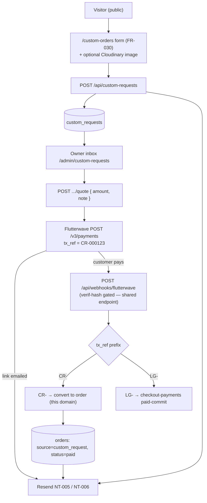
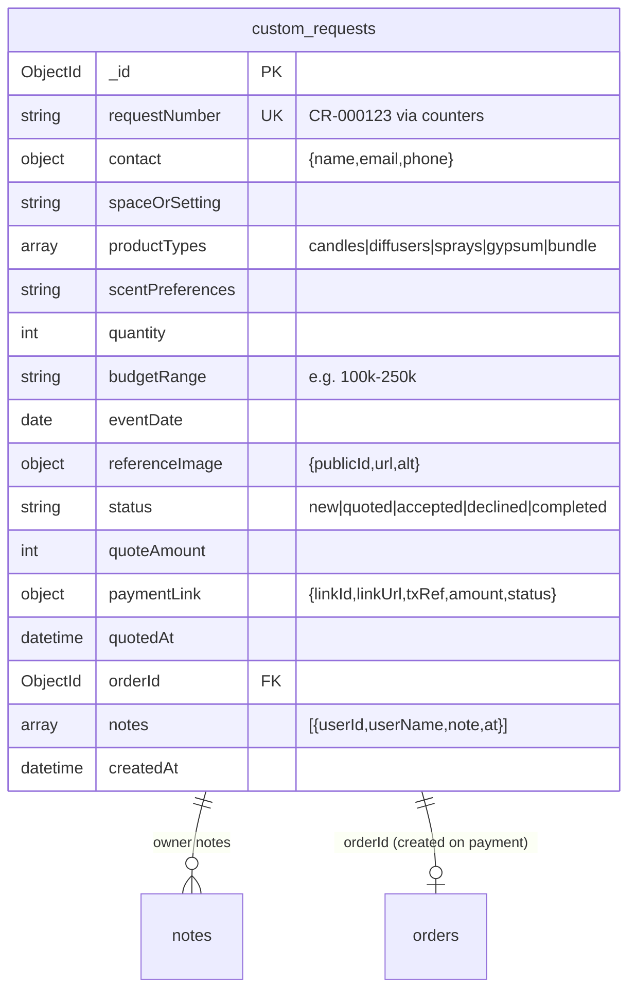

# Technical Specification: Custom Orders & Bespoke Requests

Domain: **custom-orders** — the public request form, the admin inbox, the quote workflow and
the payment link that converts an accepted quote into a real paid order in `orders`
(AD-046, FR-030/031, §7.3, AC-010).

Shared contract: `workflows/README.md` §3. The `payments`/`orders` collections and the Flutterwave
webhook endpoint are owned by `checkout-payments`; this domain **reuses** the webhook entry point
by registering a `CR-` tx_ref branch (§4) so there is exactly one signed webhook handler.

## 1. Executive Summary & Architecture Overview

A custom request is a lightweight lead document (`custom_requests`) with its own status machine
(`new → quoted → accepted → declined/completed`, AD-046). Quoting never mutates the catalog:
the owner records a `quoteAmount` and the system asks Flutterwave for a one-off payment link
with `tx_ref = CR-<requestNumber>` (same `POST /v3/payments` integration). When Flutterwave
confirms that link (the **same** signed + re-verified webhook as cart orders), the handler
converts the request into an `orders` document — `source: "custom_request"`, one line item
describing the bespoke work, `status: paid` — so "the paid order appears in Orders like any
other" (§7.3.4). The customer gets the quote email with the link (NT-006); the request form
sends acknowledgement + owner alert (NT-005).

## 2. Feature Flowchart & Infrastructure Integration (Mermaid)



## 3. Architecture & Data Modeling

### 3.1 Entity Relationship Diagram



### 3.2 Native schema (Mongoose)

```typescript
// web/src/lib/db/models/customRequest.ts
const CustomRequestSchema = new Schema(
  {
    requestNumber: { type: String, required: true, unique: true },  // CR-000123
    contact: {
      name: { type: String, required: true, trim: true, maxlength: 120 },
      email: { type: String, required: true, lowercase: true, trim: true },
      phone: { type: String, required: true },                       // Nigerian format
    },
    spaceOrSetting: { type: String, required: true, maxlength: 200 }, // "Short-let in Lekki"
    productTypes: [{ type: String, enum: ["candles", "diffusers", "sprays", "gypsum", "bundle"] }],
    scentPreferences: { type: String, required: true, maxlength: 1000 },
    quantity: { type: Number, default: 1 },
    budgetRange: { type: String, default: "" },                      // free text band
    eventDate: { type: Date, default: null },
    referenceImage: { publicId: String, url: String, alt: String },
    status: { type: String, enum: ["new", "quoted", "accepted", "declined", "completed"], default: "new", index: true },
    quoteAmount: { type: Number, default: null },                    // integer Naira
    paymentLink: {
      linkId: String, linkUrl: String, txRef: String,
      amount: Number, status: { type: String, enum: ["pending", "successful", "failed"] },
    },
    quotedAt: { type: Date, default: null },
    orderId: { type: Schema.Types.ObjectId, ref: "Order", default: null },
    notes: [{ userId: Schema.Types.ObjectId, userName: String, note: String, at: Date }],
  },
  { timestamps: true },
);
```

### 3.3 Migration

| Migration | Up | Down |
|---|---|---|
| `20261110000004-custom-requests.js` | Create `custom_requests` + indexes | Drop collection |

### 3.4 Indexing strategy

| Index | Query |
|---|---|
| `{ status: 1, createdAt: -1 }` | admin inbox by status, newest first (AD-046) |
| `{ "contact.email": 1 }` | owner search by requester |
| `{ requestNumber: 1 }` unique | quote/payment link tx_ref resolution |
| `{ "paymentLink.txRef": 1 }` | webhook CR- branch lookup |

### 3.5 Status machine

```text
new ──quote──► quoted ──payment received──► accepted ──fulfilled──► completed
 │                └──decline──► declined
 └──decline──► declined (pre-quote)
```

- `quote` sets `quoteAmount`, `paymentLink`, `quotedAt` and status `quoted`; re-quoting
  generates a fresh link and emails NT-006 again (allowed while `quoted`).
- `accepted` is set **automatically** by the webhook when the CR payment link is paid
  (the "On acceptance" of §7.3.4 — payment is the acceptance signal); the owner can also set
  it manually for pay-offline arrangements.
- `completed` = fulfilled (terminal for the inbox, order may still move independently).

### 3.6 Atomicity & idempotency

- Webhook CR- branch: `CustomRequest.findOneAndUpdate({ requestNumber: txRef,
  "paymentLink.status": { $ne: "successful" } }, { "paymentLink.status": "successful",
  status: "accepted", $push: notes }, { new: true })` — exactly-once guard; duplicate
  deliveries no-op.
- Order creation from a request is guarded by `orderId: null` on the same update; the created
  order is linked back atomically.
- Payment amount must equal `quoteAmount` (same guard style as checkout §3.6), else NT-008.

### 3.7 Security & authorization rules

- `POST /api/custom-requests` is **public** (rate limit 5/min/IP; honeypot field + submit-time
  throttle for spam). Optional image uses the **public** Cloudinary unsigned preset
  `ligera_custom_requests` restricted to images ≤ 5MB (separate from the admin-signed flow).
- Inbox, status, quote: **owner only** (staff role has orders+inventory scope per AD-002;
  custom requests are commercial/pricing work).
- Reference images stored in an isolated Cloudinary folder; `alt` from a fixed label (accessibility).

## 4. API Architecture & Contracts Summary

| Method | Path | Auth |
|---|---|---|
| POST | `/api/custom-requests` | public |
| GET | `/api/admin/custom-requests` | owner |
| GET | `/api/admin/custom-requests/:id` | owner |
| PATCH | `/api/admin/custom-requests/:id/status` | owner |
| POST | `/api/admin/custom-requests/:id/quote` | owner |

*(Webhook routing lives in `checkout-payments` `POST /api/webhooks/flutterwave` — the shared
handler dispatches on `tx_ref` prefix: `LG-` → order paid-commit, `CR-` →
`handleCustomRequestPayment` defined in this domain's services.)*

## 5. Verification & Testing Strategy

- Unit: status machine transitions; amount guards.
- Integration: submit → inbox row + NT-005 pair enqueued; quote → link persisted + NT-006
  with link; CR- webhook success → request `accepted`, order created (`source:
  custom_request`, status `paid`, snapshot line), duplicate webhook no-op; amount mismatch →
  NT-008; staff → 403 on inbox routes.
- E2E manual: AC-010 full path (form → emails → quote → payment → order in Orders).
