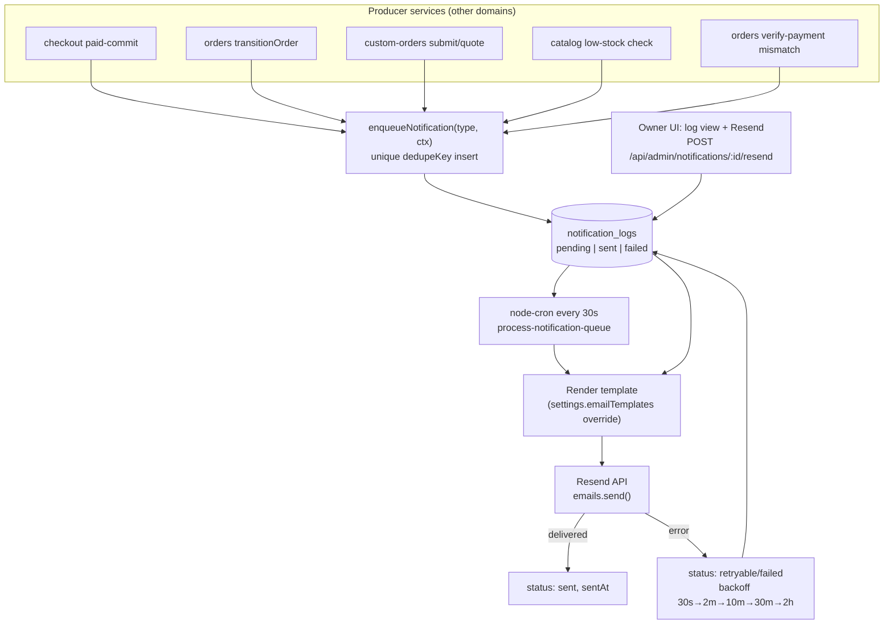
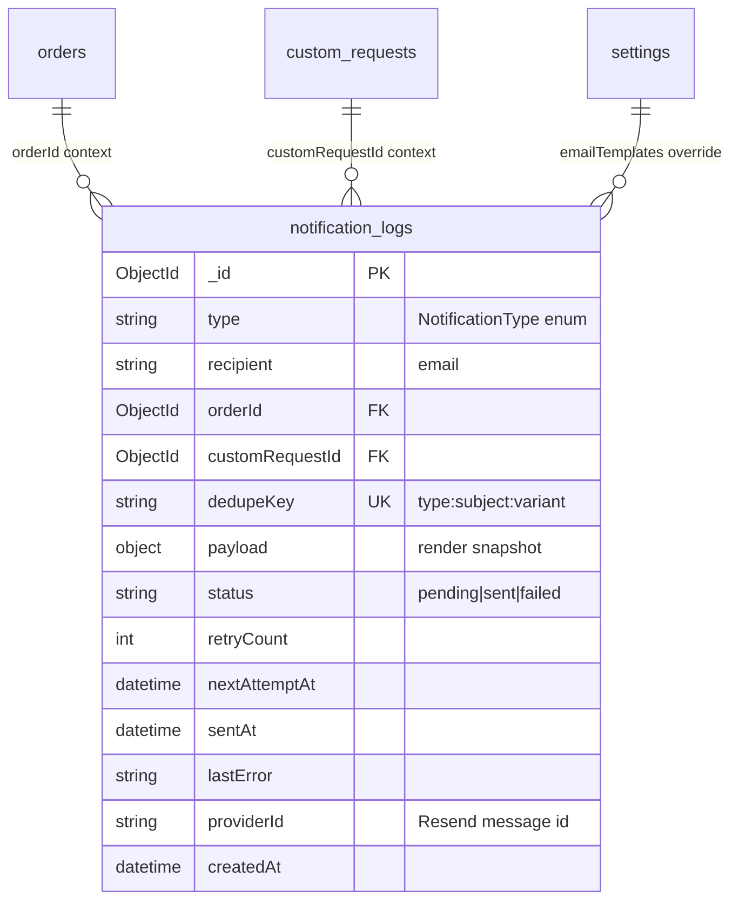

# Technical Specification: Transactional Email, Queue & Retry

Domain: **notifications** — the `enqueueNotification` service every other domain calls, the
durable queue (`notification_logs`), the 30-second processing cycle, Resend delivery with
retry/backoff, once-per-event dedupe, branded mobile-first templates, and the owner's
resend-from-admin action.

Shared contract: `workflows/README.md` §3.2 (`NotificationType` enum). Scheduler host:
platform domain (`process-notification-queue` cron, every 30 s).

## 1. Executive Summary & Architecture Overview

Notifications are **rows, not fire-and-forget calls**: producers insert one `notification_logs`
document per event with a unique `dedupeKey`; a single processor (cron, every 30 s) picks up
`pending`/`retryable` rows, renders the branded template, sends via **Resend**, and stamps the
outcome. This shape delivers every §10 rule structurally:

- **Once per event** — the `dedupeKey` unique index rejects duplicate inserts (duplicate
  Flutterwave webhooks simply re-enqueue the same key and get `null` back).
- **≤ 60 s to inbox (G5)** — 30-second poll ⇒ worst case ~35 s from enqueue to first send.
- **Failed sends retried and logged** — `retryCount < 5` with exponential backoff
  (30s → 2m → 10m → 30m → 2h); terminal failure marked `failed` with `lastError`, visible to
  the owner, resendable with one click.
- **Never for failed/abandoned payments** — only the paid-commit path enqueues NT-001/002
  (checkout-payments steps §4–5 guarantee this).
- **Template wording/logo editable** (AD-063) — template text renders from
  `settings.emailTemplates` with code defaults.

Domain auth for the log endpoints is **owner** (message history is business data).

## 2. Feature Flowchart & Infrastructure Integration (Mermaid)



## 3. Architecture & Data Modeling

### 3.1 Entity Relationship Diagram



### 3.2 Native schema (Mongoose)

```typescript
// web/src/lib/db/models/notificationLog.ts
const NotificationLogSchema = new Schema(
  {
    type: { type: String, enum: NOTIFICATION_TYPES, required: true }, // README §3.2
    recipient: { type: String, required: true, lowercase: true },     // email
    orderId: { type: Schema.Types.ObjectId, ref: "Order", default: null, index: true },
    customRequestId: { type: Schema.Types.ObjectId, ref: "CustomRequest", default: null, index: true },
    dedupeKey: { type: String, required: true, unique: true },
    payload: { type: Schema.Types.Mixed, required: true },  // render snapshot (no card data)
    status: { type: String, enum: ["pending", "sent", "failed"], default: "pending", index: true },
    retryCount: { type: Number, default: 0 },
    nextAttemptAt: { type: Date, default: () => new Date() },
    sentAt: { type: Date, default: null },
    lastError: { type: String, default: null },
    providerId: { type: String, default: null },
  },
  { timestamps: { createdAt: true, updatedAt: true } },
);
```

### 3.3 Migration

| Migration | Up | Down |
|---|---|---|
| `20261110000005-notification-logs.js` | Create `notification_logs` + §3.4 indexes | Drop collection |

### 3.4 Indexing strategy

| Index | Query pattern |
|---|---|
| `{ dedupeKey: 1 }` unique | once-per-event insert guard (rule 2) |
| `{ status: 1, nextAttemptAt: 1 }` | processor sweep: due pending/retryable rows |
| `{ orderId: 1, createdAt: -1 }` | order-page log view + resend target |
| `{ createdAt: -1 }` | admin log paging |

### 3.5 Producer contract — `enqueueNotification()`

```typescript
// web/src/lib/services/notifications/enqueue.ts
type NotificationType = "order.paid.customer" | "order.paid.owner" | "order.status.customer"
  | "order.cancelled.customer" | "custom_request.submitted.customer"
  | "custom_request.submitted.owner" | "custom_request.quoted.customer"
  | "stock.low.owner" | "payment.mismatch.owner";

export async function enqueueNotification(type: NotificationType, ctx: {
  orderId?: string; customRequestId?: string; variant?: string;   // variant e.g. target status
  payload: Record<string, unknown>;                               // render snapshot
}): Promise<{ inserted: boolean }> {
  const dedupeKey = `${type}:${ctx.orderId ?? ctx.customRequestId}${ctx.variant ? `:${ctx.variant}` : ""}`;
  const recipient = await resolveRecipient(type, ctx);            // from order/custom request/settings
  const res = await NotificationLog.findOneAndUpdate(
    { dedupeKey },
    { $setOnInsert: { type, recipient, orderId: ctx.orderId, customRequestId: ctx.customRequestId,
        payload: ctx.payload, status: "pending", retryCount: 0, nextAttemptAt: new Date() } },
    { upsert: true, new: true },
  );
  return { inserted: res.createdAt?.getTime() === res.updatedAt?.getTime() }; // duplicate → false
}
```

Dedupe keys in use (normative):

| Type | dedupeKey |
|---|---|
| `order.paid.customer` / `order.paid.owner` | `type:<orderId>` |
| `order.status.customer` | `order.status.customer:<orderId>:<targetStatus>` |
| `order.cancelled.customer` | `order.cancelled.customer:<orderId>:<cancelled|refunded>` |
| `custom_request.submitted.*` / `custom_request.quoted.customer` | `type:<customRequestId>` |
| `stock.low.owner` | `stock.low.owner:<variantId>:<yyyy-mm-dd>` (daily per variant) |
| `payment.mismatch.owner` | `payment.mismatch.owner:<orderId>` |

### 3.6 Queue processing cycle (cron, 30 s) & retry policy

1. Sweep: `notification_logs.find({ status: "pending", nextAttemptAt: { $lte: now } }).limit(50)`
   (failed rows live at `status: "failed"` only after 5 attempts; retryable rows stay
   `pending` with raised `retryCount`/`nextAttemptAt`).
2. Per row: render → `resend.emails.send()` → on success `findOneAndUpdate({ _id, status:
   "pending" }, { status: "sent", sentAt, providerId })`; the guard makes double-send
   impossible even if two cycles overlap.
3. On error: `retryCount + 1`; if < 5 → backoff schedule `[30s, 2m, 10m, 30m, 2h]` and keep
   `pending`; at 5 → `status: "failed"`, `lastError` recorded (truncated, no PII beyond
   address).
4. Batch of 50 per cycle; head-of-line safety via per-row guards; errors captured to
   `captureError()`.

## 4. Templates (Ligera-branded, mobile-first, plain language)

`web/src/lib/services/notifications/templates/<type>.tsx` — shared layout component
`EmailLayout` (gold logo mark, ivory background, charcoal text, Fraunces heading, Inter body,
single-column ≤ 600px, footer with contact + WhatsApp + unsubscribe-for-marketing note).
Content fields per type (mapping NT-001…008): receipts list items/fee/total/address/window;
status updates lead with the status in plain words; NT-006 embeds the payment-link button.
Text blocks read from `settings.emailTemplates[type]` overrides first (AD-063), falling back
to code defaults — the owner edits wording/logo from admin-portal settings; preview via
`GET /api/admin/notifications/:id/preview` (HTML render).

Send identity: `EMAIL_FROM` (e.g. `Ligera <orders@ligera.ng>`); Resend domain configured
with SPF, DKIM, DMARC (launch checklist §18; documented in `.env.example`).

## 5. API Architecture & Contracts Summary

| Method | Path | Auth |
|---|---|---|
| GET | `/api/admin/notifications` | owner |
| GET | `/api/admin/notifications/:id/preview` | owner |
| POST | `/api/admin/notifications/:id/resend` | owner |

## 6. Verification & Testing Strategy

- Unit: dedupe-key builder; backoff schedule; template rendering (contains order number,
  totals, window; prices hidden variant for gift receipts is **not** needed in email —
  customer sees their own prices).
- Integration: duplicate enqueue is a no-op (`inserted: false`, single row); processor sends
  exactly one Resend call per row; send failure → retryCount/backoff; 5th failure →
  `failed` + `lastError`; resend action resets and re-processes; NT-001 enqueued at
  paid-commit time reaches "sent" within a simulated 30 s cycle (fake timers).
- Staging: real Resend sandbox domain → inbox + spam-folder check per §18.
