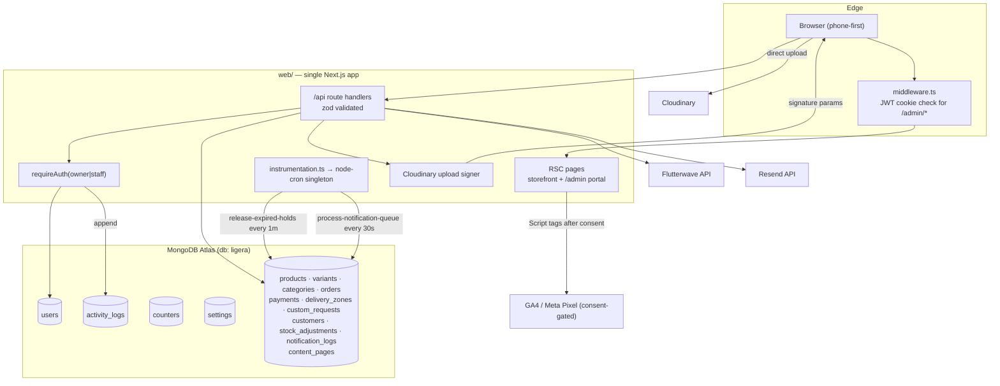
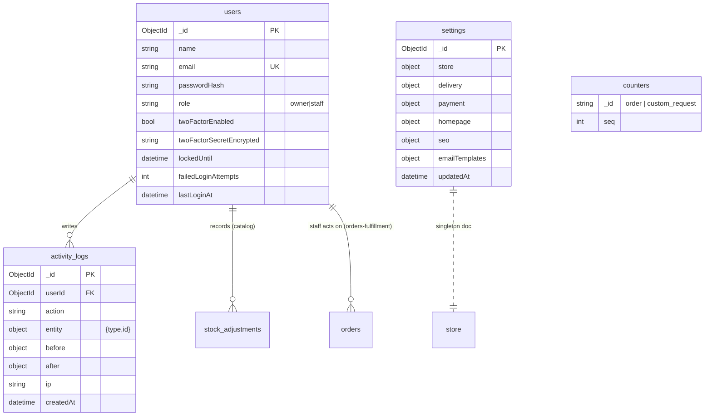

# Technical Specification: Ligera Platform Foundation

Domain: **platform** — the single fullstack Next.js application, MongoDB Atlas persistence, admin
authentication, upload signing, background scheduler, analytics/SEO infrastructure, and the
migration from the current Vite + Express + Supabase prototype.

## 1. Executive Summary & Architecture Overview

Ligera is rebuilt as **one Next.js 15 App Router application** (TypeScript, strict mode) living in
`web/` (renamed package `ligera-web`). It serves the SSR storefront, the login-protected
admin portal, and the unversioned REST API (`/api/*` route handlers validated with zod). All
state lives in **MongoDB Atlas** (Mongoose ODM, db `ligera`). The retired `backend/` Express
service and all Supabase dependencies (Postgres, Auth, Storage) are removed by a scripted
migration that carries seed data forward.

**Why single app (interview D2/D3):** low-volume handmade store; one Node process + Atlas is the
least-resource topology that still meets §8–11. SSR covers FR-042 SEO; route handlers cover the
REST API; `instrumentation.ts` hosts the node-cron scheduler (hold release, email retries) so no
extra worker process exists (PRD §12 "background jobs" satisfied by an in-process scheduler).

### Layers

| Layer | Technology | Notes |
|---|---|---|
| UI | Next.js App Router (RSC + client components), Tailwind 4, shadcn/ui + Watermelon UI excerpts | Mobile-first from 360px (§11) |
| API | Next.js route handlers (`app/api/**/route.ts`), zod DTOs | Unversioned `/api` (D10) |
| Auth | Custom JWT (jose) + bcrypt, httpOnly cookies, TOTP 2FA optional for Owner | AD-001–003 |
| Data | Mongoose 8 → MongoDB Atlas | 15 collections (README §3.1) |
| Jobs | node-cron singleton in `instrumentation.ts` | `release-expired-holds`, `process-notification-queue` |
| Payments | Flutterwave REST v3 (payment links) | checkout-payments domain |
| Email | Resend Node SDK | notifications domain |
| Images | Cloudinary signed direct upload + `f_auto,q_auto` delivery | this domain |
| Analytics | GA4 + Meta Pixel behind a cookie-consent gate | FR-043, FR-051 |
| Testing | Vitest + mongodb-memory-server + Testing Library | implementation.md |

### Security model

- HTTPS everywhere (host-level); **no card data ever reaches Ligera** — Flutterwave hosted links
  only (§11 Security, D5).
- Admin API guarded per-route by `requireAuth(...roles)`; `middleware.ts` redirects
  unauthenticated `/admin` page visits to `/admin/login` (AD-002 role matrix in README §3.6).
- Login rate limiting: 5 failures per email per 15 min → `users.lockedUntil` (§11 Security).
- Every admin mutation writes an append-only `activity_logs` entry (AD-003).
- Secrets only via env (`MONGODB_URI`, `JWT_*`, `FLW_*`, `CLOUDINARY_*`, `RESEND_API_KEY` — README
  §3.9). No secrets or unmasked PII in logs.

## 2. Feature Flowchart & Infrastructure Integration (Mermaid)



## 3. Architecture & Data Modeling (platform-owned collections)

Domain-owned collections here: `users`, `activity_logs`, `counters`, `settings`. The other 11
collections are specified in their domain folders (README §3.1).

### 3.1 Entity Relationship Diagram (platform slice)



### 3.2 Native schema (Mongoose) — `web/src/lib/db/models/*.ts`

Follows the repo's ESM TypeScript style. Connection singleton first:

```typescript
// web/src/lib/db/connect.ts
import mongoose from "mongoose";

let connected = false;
export async function connectDb(): Promise<void> {
  if (connected) return;
  await mongoose.connect(process.env.MONGODB_URI!, { dbName: "ligera" });
  connected = true;
}
```

```typescript
// web/src/lib/db/models/user.ts
import mongoose, { Schema, type Model } from "mongoose";

export interface IUser {
  _id: mongoose.Types.ObjectId;
  name: string;
  email: string;
  passwordHash: string;
  role: "owner" | "staff";
  twoFactorEnabled: boolean;
  twoFactorSecretEncrypted?: string | null;
  failedLoginAttempts: number;
  lockedUntil?: Date | null;
  lastLoginAt?: Date | null;
  createdAt: Date;
  updatedAt: Date;
}

const UserSchema = new Schema<IUser>(
  {
    name: { type: String, required: true, trim: true, maxlength: 120 },
    email: { type: String, required: true, unique: true, lowercase: true, trim: true, index: true },
    passwordHash: { type: String, required: true },
    role: { type: String, enum: ["owner", "staff"], required: true },
    twoFactorEnabled: { type: Boolean, default: false },
    twoFactorSecretEncrypted: { type: String, default: null }, // AES-256-GCM at rest
    failedLoginAttempts: { type: Number, default: 0 },
    lockedUntil: { type: Date, default: null },
    lastLoginAt: { type: Date, default: null },
  },
  { timestamps: true },
);

export const User: Model<IUser> =
  mongoose.models.User ?? mongoose.model<IUser>("User", UserSchema);
```

```typescript
// web/src/lib/db/models/activityLog.ts
const ActivityLogSchema = new Schema(
  {
    userId: { type: Schema.Types.ObjectId, ref: "User", required: true, index: true },
    action: { type: String, required: true },            // e.g. "product.price.update"
    entity: { type: { type: { type: String }, id: String }, required: true },
    before: { type: Schema.Types.Mixed, default: null }, // immutable audit snapshot
    after: { type: Schema.Types.Mixed, default: null },
    ip: { type: String, default: null },
  },
  { timestamps: { createdAt: true, updatedAt: false } }, // append-only: no update path
);
```

```typescript
// web/src/lib/db/models/counter.ts — atomic sequence source
const CounterSchema = new Schema({ _id: String, seq: { type: Number, default: 0 } });
export async function nextNumber(key: "order" | "custom_request"): Promise<string> {
  const doc = await Counter.findOneAndUpdate(
    { _id: key },
    { $inc: { seq: 1 } },
    { upsert: true, new: true },
  );
  const prefix = key === "order" ? "LG-" : "CR-";
  return `${prefix}${String(doc.seq).padStart(6, "0")}`;
}
```

`settings` is a singleton document with subdocuments `store`, `delivery`
(`freeDeliveryThreshold`, `cutOffTime`, `blackoutDates[]`, `pickup{enabled,address,hours}`),
`payment{payOnDelivery:false}`, `homepage`, `seo`, `emailTemplates` — full shape specified in
`admin-portal/specs.md`; seeded by `scripts/seed-settings.ts`.

### 3.3 Indexing strategy

| Collection | Index | Justification |
|---|---|---|
| `users` | `{ email: 1 }` unique | login lookup; prevents duplicate accounts |
| `activity_logs` | `{ createdAt: -1 }`, `{ userId: 1, createdAt: -1 }` | reverse-chronological admin log paging |
| `counters` | `{ _id }` (natural) | single atomic `findOneAndUpdate` per number issue |

### 3.4 Atomicity, concurrency & idempotency

- Order/custom-request numbers: atomic `$inc` on `counters` (no duplicates under concurrency).
- Auth: lockout uses conditional `findOneAndUpdate({ email, $or: [{ lockedUntil: null }, { lockedUntil: { $lt: now } }] }, ...)` so concurrent guesses cannot bypass the lock.
- All other cross-collection atomicity is owned by the respective domains (stock holds use
  single-document `findOneAndUpdate` — README §3.4).

## 4. Authentication design (AD-001–002)

- **Passwords:** bcrypt cost 12. Seeded owner account via `scripts/seed-owner.ts`
  (`OWNER_EMAIL`/`OWNER_PASSWORD` env, role `owner`).
- **Tokens:** `jose` JWTs — access 15 min (`ligera_at`, httpOnly, SameSite=Lax, Secure) and
  refresh 7 days (`ligera_rt`, httpOnly, path `/api/auth`). Refresh rotates on use.
- **Login flow:** lookup by email → lockout check (429 `AUTH_LOCKED`) → bcrypt compare → if
  `twoFactorEnabled`, require valid TOTP (401 `TOTP_REQUIRED`) → set cookies, reset
  `failedLoginAttempts`, stamp `lastLoginAt`, write `activity_logs`
  (`auth.login`).
- **2FA (Owner, optional):** `otpauth` TOTP secret generated at `POST /api/auth/2fa/setup`
  (returned once as an otpauth:// URI + QR), verified 3 times before
  `POST /api/auth/2fa/enable` persists it AES-256-GCM encrypted (`twoFactorSecretEncrypted`,
  key derived from `JWT_ACCESS_SECRET` via scrypt).
- **Password reset:** `POST /api/auth/password/request-reset` emails a single-use token
  (24h TTL, HMAC-signed, stored hashed in `users.resetTokenHash`); `confirm-reset` rotates it.
- **Route guards:** `requireAuth()` / `requireRole("owner")` helpers in
  `src/lib/auth/guard.ts` read the access cookie, verify JWT, load role, and stamp
  `req.headers["x-user-id"]` context. `middleware.ts` mirrors the check for `/admin` pages.

## 5. Background scheduler (PRD §12 jobs)

`instrumentation.ts` (Next.js `register()` hook — runs once per server process):

```typescript
import { registerScheduler } from "@/lib/jobs/scheduler";
export async function register() {
  if (process.env.NEXT_RUNTIME === "nodejs" && process.env.ENABLE_SCHEDULER !== "false") {
    registerScheduler(); // node-cron singleton, env-gated, double-start safe
  }
}
```

| Job | Cron | Body (domain-linked) |
|---|---|---|
| `release-expired-holds` | `0 * * * * *` (every minute) | checkout-payments `specs.md §6` |
| `process-notification-queue` | `*/30 * * * * *` (every 30s) | notifications `specs.md §4` |

Both jobs are idempotent and safe to run concurrently with request handling.

## 6. Image pipeline — Cloudinary (FR-002, G7, AC-011)

- **Upload:** browser asks `POST /api/admin/uploads/sign` → backend returns Cloudinary signed
  params (`timestamp`, `folder=ligera/products`, signature) → browser POSTs the file directly
  to Cloudinary (zero image bytes through the app; least resources).
- **Delivery:** `https://res.cloudinary.com/<cloud>/image/upload/f_auto,q_auto,w_<width>/v.../`
  — `f_auto` serves WebP/AVIF by Accept header; card width 400 targets ≤ 150KB mobile cards.
- **Storage:** documents store `{ publicId, alt, width, height, position }`; alt text mandatory
  (AC-013 — client form requires it).

## 7. Analytics, consent, SEO & errors

- **GA4 + Meta Pixel (FR-043):** loaded via `next/script` only after cookie consent
  (`CookieConsent` component, FR-051 — banner, `localStorage` flag, granular
  analytics/marketing toggles). Events fired client-side: `add_to_cart` (AddToCart),
  `begin_checkout` (InitiateCheckout), `purchase` (Purchase — on `/order/[orderNumber]`
  confirmation only, guarded by a `purchased` sessionStorage flag).
- **SEO (FR-042/044):** `generateMetadata` per route; JSON-LD `Organization` in root layout and
  `Product` on product pages; `app/sitemap.ts` streams products from Mongo; `app/robots.ts`.
  OG/Twitter cards with Cloudinary og:image.
- **Branded errors:** `not-found.tsx` + `error.tsx` in Ligera brand styling, plain-language copy
  and a route back to `/shop` (§11 Usability "no dead ends").
- **Monitoring:** `console.error` with structured JSON now; Sentry-ready via a single
  `captureError()` wrapper (PRD §12 monitoring).

## 8. Brand & design system (D11)

Tailwind 4 tokens in `web/src/styles.css`:

```css
@theme {
  --color-brand-gold: #b08d57;      /* logo mark, accents */
  --color-brand-ivory: #faf7f2;     /* page background */
  --color-brand-sand: #ece4d8;      /* section background */
  --color-brand-clay: #c8a487;      /* borders, dividers */
  --color-brand-charcoal: #2b2622;  /* text */
  --font-display: "Fraunces", serif; /* restrained display serif */
  --font-sans: "Inter", sans-serif;
}
```

- shadcn/ui components already in `web/src/components/ui/**` carry over untouched.
- **Watermelon UI excerpts** to vendor into `src/components/motion/*` (from ui.watermelon.sh,
  same Tailwind/Radix foundation): `RevealOnScroll` (home sections), `HoverLift` (product
  cards), `Marquee` (Instagram strip), `CountUpStat` (dashboard headline numbers),
  `MagneticButton` (primary CTAs). Each is a small copied excerpt with attribution comment,
  WCAG-checked (reduced-motion respected, keyboard focus preserved — AC-013).
- Two-per-row product grid from 390px (§14), sticky mobile add-to-cart bar (§11).

## 9. Testing strategy

- **Runner:** Vitest (`vitest.config.ts` with `environment: "node"`, jsdom for component tests)
  — new `test` script: `vitest run`; `test:watch`, `coverage` scripts added.
- **DB in tests:** `mongodb-memory-server` via a `setupFiles` global that swaps
  `MONGODB_URI`.
- **Route handler tests:** invoke exported `GET/POST/PATCH/...` directly with constructed
  `NextRequest` objects; external HTTP (Flutterwave, Resend, Cloudinary) mocked with
  `vi.fn()` modules.
- **Component tests:** Testing Library `render` + `userEvent`.

## 10. Migration from current prototype (fresh rebuild, D3)

| Step | Action |
|---|---|
| M1 | Scaffold Next.js App Router inside `web/` (new `app/`, `lib/`, keep `components/ui/**`, `styles.css` tokens); remove Vite config, `router.tsx`, `routeTree.gen.ts`, `routes/` |
| M2 | Add deps: `next`, `mongoose`, `zod` (present), `bcryptjs`, `jose`, `otpauth`, `node-cron`, `cloudinary`, `resend`, `vitest`, `@testing-library/react`, `mongodb-memory-server` |
| M3 | `scripts/migrate-from-supabase.ts`: reads legacy `products` + `orders` + `order_items` via `@supabase/supabase-js` (env `LEGACY_SUPABASE_URL`/`LEGACY_SUPABASE_SERVICE_ROLE_KEY`, one-off), maps each legacy product → one `products` doc (`status` from `active`, `notes` → description, seed category by legacy `category` string) + one variant per product (price/stock/threshold/sku from name); each legacy order → `orders` (status mapped `pending→pending_payment`, `confirmed→paid`, `fulfilled→delivered`, `cancelled→cancelled`) + `payments` doc (`paymentStatus` `pending`, provider `flutterwave`, note: historical). Idempotent — keyed by legacy id stored in `externalRef` |
| M4 | Seed `counters` (order seq = legacy max + 1), `settings` (defaults + `delivery.zones` from legacy flat ₦3,500 as "Lagos Mainland"), `content_pages` (starter copy), one `owner` user |
| M5 | Delete `backend/`, remove Supabase deps from `web/package.json`, collapse `docker-compose.yml` to a single `web` service (optional local run), update `README.md` |
| M6 | Verify: `npm run build` + full test suite green; smoke `/api/health`, catalog read, admin login |

Rollback: the legacy `backend/` + Supabase project are untouched until M5 cutover (git branch
`platform-migration`), so revert = redeploy previous branch; Supabase project kept read-only for
30 days as backup.

## 11. Verification & testing strategy

| Level | Covers |
|---|---|
| Unit | JWT sign/verify, bcrypt hash, lockout logic, TOTP verify, counter sequence, Cloudinary signer |
| Integration (mongodb-memory-server) | login/refresh/logout happy + failure paths, activity log writes, 2FA enable flow |
| E2E (manual UAT) | AC-014 first-time buyer flow (owner-run) |
